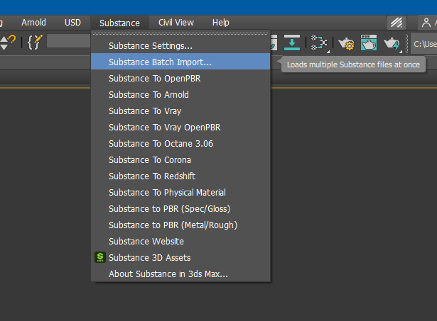

# Importación por lotes

Puede importar varios archivos de Substance .sbsar por lotes mediante la función Importación por lotes.

1. Vaya a Configuración del Substance en la parte superior de la interfaz de usuario de 3ds Max y elija Substance > Importar lote .

1. Elija los archivos .sbsar que desee importar.

   
