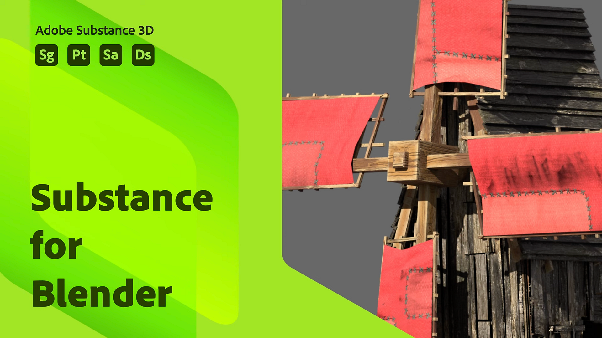

# Mezclador

## Tabla de contenido

* [Substance en Blender Descripción general](../../3d-applications/blender/in-blender-overview/substance-in-blender-overview.md)
* [Descarga e instalación del complemento](../../3d-applications/blender/downloading-and-ins/downloading-and-installing-the-plugin.md)
* [Preferencias](../../3d-applications/blender/preferences/preferences.md)
* [El panel Substance 3D](../../3d-applications/blender/the-3d-panel/the-substance-3d-panel.md)
* [Accesos directos y navegación](../../3d-applications/blender/shortcuts-and-navigation/shortcuts-and-navigation.md)
* [Flujos de trabajo](../../3d-applications/blender/workflows/workflows.md)
* [Tamaño físico en Blender](../../3d-applications/blender/physical-size-in-blender/physical-size-in-blender.md)
* [Biblioteca de Substance 3D Assets](../../3d-applications/blender/3d-assets-library/substance-3d-assets-library.md)
* [Resolución de problemas](../../3d-applications/blender/troubleshooting/troubleshooting.md)
* [Desinstalación del complemento](../../3d-applications/blender/uninstalling-the-add-on/uninstalling-the-add-on.md)
* [Complemento de Substance 3D para Tutorials de Blender](../../3d-applications/blender/add-for-blender-tutorials/substance-3d-add-on-for-blender-tutorials.md)
* [Notas de la versión](release-notes/release-notes.md)
