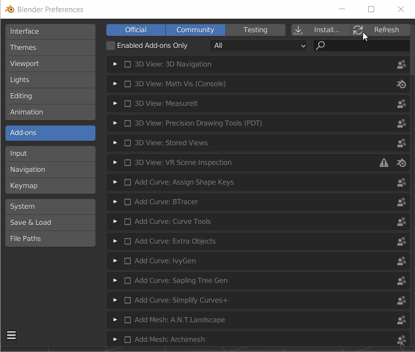

# Descarga e instalación del complemento

## Descargar

Para descargar el complemento, visita [Substance 3D en Blender](https://substance3d.adobe.com/plugins/substance-in-blender/). Haga clic en **Descargar el complemento** para iniciar la descarga.

También puede obtener la versión más reciente directamente en los vínculos siguientes.

Hay dos archivos .zip independientes para descargar e instalar:

* Complemento de Substance 3D para Blender ([descarga única para todas las plataformas](https://www.adobe.com/go/substance3d-blender-multi-latest))
* Herramientas de integración de Substance 3D (descarga las versiones de [Windows](https://www.adobe.com/go/substance3d-integrationtools-win-latest), [Mac](https://www.adobe.com/go/substance3d-integrationtools-mac-latest) o [Linux](https://www.adobe.com/go/substance3d-integrationtools-lin-latest))

>[!WARNING]
>
> **Para usuarios de Mac:** *Los usuarios deben deshabilitar &quot;abrir archivos seguros después de la descarga&quot; si están descargando el complemento con Safari.*
>
> De forma predeterminada, el navegador web Safari descomprime los archivos .zip descargados, que deben permanecer comprimidos para la instalación. Para evitar que el archivo se descomprima, actualice las preferencias de Safari para no abrir archivos &quot;seguros&quot; después de la descarga.
>
> 1. Abrir Safari
> 1. Haga clic en **Preferencias**
> 1. En la pestaña General, desmarque la opción **Abrir archivos &quot;seguros&quot; después de la descarga.**

## Pasos de instalación

### Primera instalación

1. Descargue los archivos .zip del complemento en la página de la versión previa del Adobe.
1. Mezclador abierto (v. 3.0 o superior).
1. En la barra de navegación superior, seleccione Editar y, a continuación, Preferencias. A continuación, seleccione la ficha Complementos .
1. Haga clic en el botón **Instalar**.
1. En el explorador de archivos, localice la carpeta donde se descargaron los archivos .zip
1. Seleccione el archivo Substance3DInBlender.zip y haga clic en el botón **Instalar complemento**.
1. En la sección Complementos, haga clic en la casilla de verificación para habilitar el complemento y haga clic en la flecha desplegable para expandir la sección.
1. Se le pedirá que instale las herramientas de integración. Haga clic en **Instalar desde disco** para seleccionar **Substance3DIntegrationTools.zip** y haga clic en el botón **Instalar herramientas**.\
   Si no se descargaron anteriormente, haz clic en **Descargar** para abrir la página de la versión previa del Adobe en tu explorador y descargar las herramientas; después, usa **Instalar desde el disco** para instalarlas.
1. El complemento ya está listo para usarse.

### Actualización del complemento y las herramientas

1. Descargue la versión más reciente de los vínculos anteriores.
1. Use el botón **Herramientas de desinstalación** para quitar Substance 3D Integration Tools.
1. Use el botón **Quitar** para desinstalar el complemento
1. Cerrar y reiniciar Blender
1. En la barra de navegación superior, seleccione Editar y, a continuación, Preferencias. A continuación, seleccione la ficha Complementos .
1. Haga clic en el botón **Instalar**.
1. En el explorador de archivos, localice los archivos ZIP recién descargados.
1. Seleccione el archivo Substance3DInBlender.zip y haga clic en el botón **Instalar** complemento.
1. En la sección Complementos, haga clic en la casilla de verificación para habilitar el complemento y haga clic en la flecha desplegable para expandir la sección.
1. Se le pedirá que instale las herramientas de integración. Haga clic en **Instalar desde el disco** para seleccionar Substance3DIntegrationTools.zip y haga clic en el botón **Instalar herramientas**.\
   Si no se descargaron anteriormente, haz clic en **Descargar** para abrir la página de la versión previa del Adobe en tu explorador y descargar las herramientas; después, usa **Instalar desde el disco** para instalarlas.
1. El complemento ya está listo para usarse.

### Actualización de componentes individuales

Al actualizar solo el complemento:

1. En las preferencias del complemento, usa el botón **Quitar** para desinstalar el complemento.
1. Reiniciar Blender
1. Vuelva a navegar a las preferencias del complemento y use el botón **Instalar** para cargar la nueva versión del complemento. Las herramientas de integración cargadas anteriormente permanecerán.

Al actualizar solo las herramientas de integración:

1. En las preferencias del complemento, use el botón **Herramientas de actualización** para cargar la versión más reciente de las Herramientas de integración. El complemento usado anteriormente permanecerá.
1. Reinicie Blender para que los cambios surtan efecto.

O

1. En las preferencias del complemento, usa el botón **Desinstalar herramientas** para quitar las herramientas de integración.
1. Reiniciar Blender
1. Utilice el botón **Instalar desde disco** para buscar y cargar la versión más reciente de las herramientas de integración. El complemento usado anteriormente permanecerá.